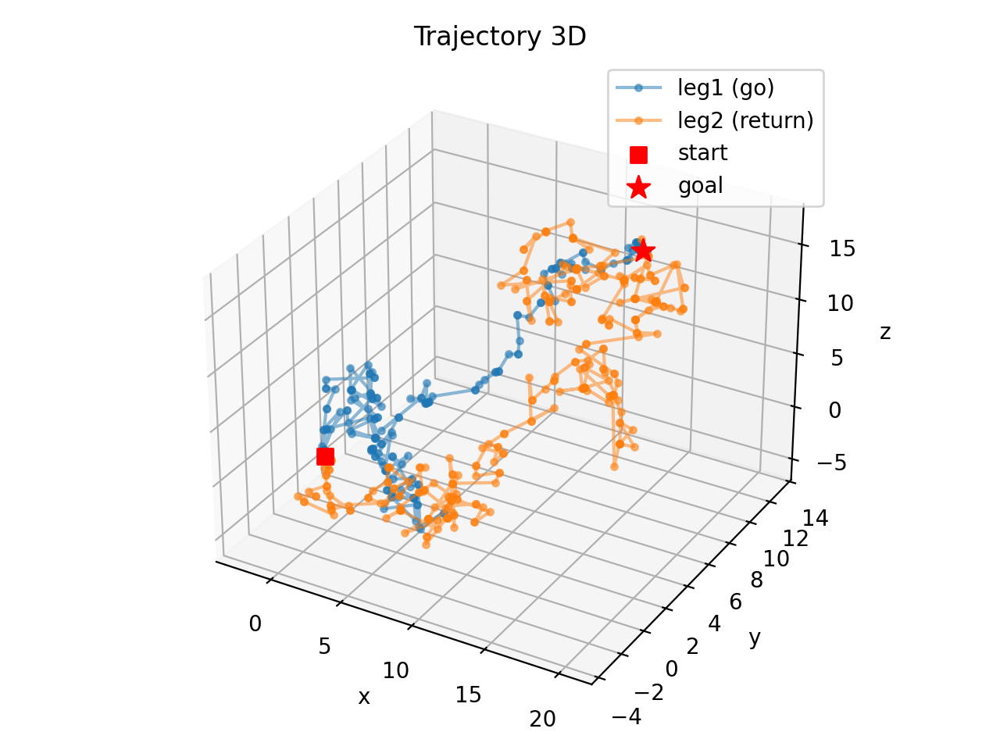

# Diffusion 후보 궤적 생성과 DQN 기반 경로 선택

학부 연구 과정에서 다룬 **굴착기 응용을 위한 후보 궤적 생성·선택 실험**입니다. Diffusion 모델이 여러 후보 경로를 만들고, DQN 정책이 현재 상태에서 사용할 후보를 선택합니다. 공개 코드는 좌표 기반 시뮬레이션과 경로 시각화를 포함합니다.

## 먼저 확인할 자료

| 내용 | 자료 |
|---|---|
| 후보 궤적 모델과 생성 설정 | [diffusion_planner.py](diffusion_planner.py) |
| 관측·행동·보상·성공 조건 | [environment_selector.py](environment_selector.py) |
| DQN 학습 | [train_rl.py](train_rl.py) |
| 편도·왕복 추론과 결과 저장 | [inference_rl.py](inference_rl.py) |
| 에피소드별 결과 | [exp3](result_goal_27_exp3/summary.csv) · [exp4](result_goal_27_exp4/summary.csv) · [exp5](result_goal_27_exp5/summary.csv) |
| 경로 좌표 예시 | [exp4 / episode 1](result_goal_27_exp4/ep_0001/inference_traj.csv) |



## 처리 흐름

1. DiffusionPlanner가 현재 위치·목표·조건에서 여러 후보 궤적을 생성합니다.
2. SelectorEnv가 후보와 목표 관련 상태를 관측으로 구성합니다.
3. DQN이 후보 인덱스를 이산 행동으로 선택합니다. 기본 후보 수는 8개입니다.
4. 선택 경로를 이용해 시뮬레이션 상태를 갱신합니다.
5. 거리·진행도·부드러움·스텝 비용·목표 도달 보상으로 정책을 학습합니다.

`exec_points` 기본값은 35입니다. 설정상 시작점을 제외한 실행 점 개수이며, 생성 경로의 총 출력 점 개수와 구분해야 합니다. [설정 클래스](diffusion_planner.py)에서 DDIM step 등 생성 조건을 함께 확인할 수 있습니다.

## 저장된 실험 결과

| 결과 폴더 | 에피소드 수 | 1구간 성공 | 왕복 모두 성공 | 확인된 조건 |
|---|---:|---:|---:|---|
| [exp3](result_goal_27_exp3/summary.csv) | 20 | 20/20 | 20/20 | goal 27, weight 0 |
| [exp4](result_goal_27_exp4/summary.csv) | 20 | 20/20 | 19/20 | goal 27, weight 0/25 혼재 |
| [exp5](result_goal_27_exp5/summary.csv) | 20 | 7/20 | 5/20 | goal 27, weight 0/25 혼재 |

각 `summary.csv`의 성공 열을 집계한 값입니다. **실험 조건이 완전히 동일하지 않으므로 모델의 우열 순위로 비교하지 않습니다.** 특정 목표의 20회 기록이며, 전체 목표·전체 연구의 성공률을 대표하지 않습니다.

## 지표 정의

| 항목 | 정의 |
|---|---|
| 구간 성공 | 목표와 최종 위치 사이 거리 `≤ goal_tol` |
| 왕복 성공률 | `leg1_success`와 `leg2_success`가 모두 참인 에피소드 수 / 전체 에피소드 수 |
| 최종 거리 | 각 구간 종료 위치와 해당 목표 사이의 좌표 공간 거리 |
| step 수 | 해당 구간에서 정책이 후보 경로를 선택한 횟수. 실제 장비 제어주기나 초 단위 시간이 아님 |

추론 스크립트의 기본 `goal_tol`은 0.5, `max_steps`는 200입니다. 과거 결과의 모든 설정을 현재 코드 기본값으로 소급하지 않습니다. `weight`는 저장된 실험 조건 열이며 별도 의미·설정 매핑 확인이 필요합니다.

## 실행 준비와 현재 제한

Python, NumPy, PyTorch, Stable-Baselines3, Gymnasium, Gym, Matplotlib, TensorBoard 등이 사용됩니다. 학습 코드에는 progress bar 의존성도 있습니다. **원래 학습 환경의 고정 버전과 검증된 requirements는 아직 정리되지 않았습니다.** Gym/Gymnasium 및 SB3 버전 호환성을 맞춰야 합니다.

필요한 모델 파일:

| 파일 | 현재 상태 |
|---|---|
| `ckpt_step_100000.pt` | 코드 기본값이지만 공개 파일 목록에는 없음. 호환되는 Diffusion checkpoint가 필요 |
| [runs_selector](runs_selector)의 `dqn_selector_1.zip`~`dqn_selector_5.zip` | DQN 정책 파일. 모델별 조건과 결과 폴더의 대응 확인 필요 |

추론 코드 기본 이름은 `dqn_selector_05.zip`이지만 공개된 파일은 `dqn_selector_5.zip`입니다. `--model`로 실제 파일을 명시합니다. 학습 코드는 새 결과를 `dqn_selector_6.zip`으로 저장하므로 기존 모델과 구분합니다.

### 모델을 확보한 뒤의 추론 예시

저장소 루트에서, 호환되는 checkpoint와 의존성을 먼저 준비한 후 실행합니다.

```bash
python inference_rl.py --ckpt ckpt_step_100000.pt --model runs_selector/dqn_selector_5.zip --device cuda --goal_id 27 --episodes 20 --round_trip 1 --exec_points 35 --ddim_steps 50 --num_candidates 8 --goal_tol 0.5 --max_steps 200 --seed 0 --deterministic --out_dir results/new_goal27
```

이 명령은 실행 인자 예시입니다. checkpoint가 없으면 실행되지 않으며, model 5가 exp5 등 특정 결과를 생성한 모델이라고 단정하지 않습니다.

### 학습 예시

```bash
python train_rl.py --ckpt ckpt_step_100000.pt --device cuda --total_steps 200000 --n_envs 4 --seed 0 --log_dir runs_selector_new
```

기존 모델·로그를 보존하기 위해 별도 출력 디렉터리를 사용합니다. 실행 후 생성되는 summary와 에피소드 CSV·그림을 같은 설정과 함께 보관합니다.

## 연구 범위와 후속 검증

- 현재 환경은 선택한 경로의 끝점으로 위치를 갱신하는 시뮬레이션입니다. 실제 굴착기 동역학·구동계·현장 제어 검증과 구분합니다.
- 목표별·seed별 공통 조건 평가와 모델 버전 대응표가 필요합니다.
- Diffusion checkpoint의 학습 코드·데이터·공개 가능 범위와 원본 구현 출처를 연결해야 전체 재현이 가능합니다.
- 본 저장소의 세 summary만으로 별도 연구의 성공률 94% 등을 입증하지 않습니다. 추가 수치는 해당 평가 기록이 연결되는 경우에만 사용합니다.

---
문서 기준: 2026-11-22 · [검토한 코드 버전](https://github.com/yoon-jr/sdm_trajectory_generation/tree/676fa5703540d15c7338aa40e26ddcbdd222992c). 수치는 저장된 실험 결과이며, 새 실행에서는 환경과 설정에 따라 달라질 수 있습니다.
